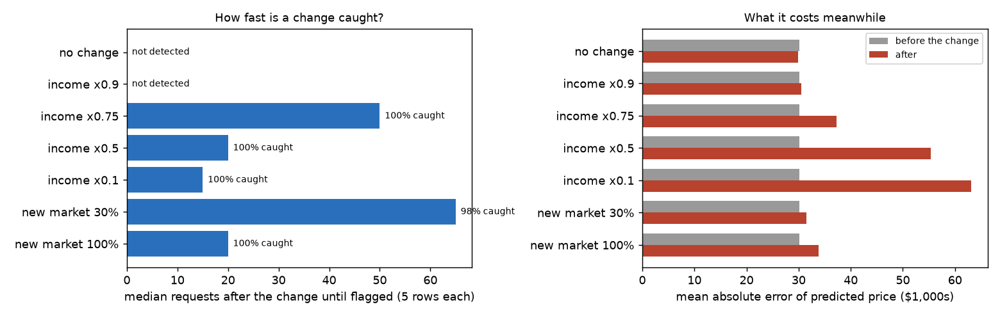

# partner-gateway: opening a machine-learning model to partners, safely

A demo of what it takes to let **outside businesses** call your model: who may call, how much, with what data, and
how you find out when a partner starts sending data that quietly breaks the predictions.

The model prices homes (XGBoost on the 1990 California census; held-out R² 0.85, typical error about $30,000). Two
simulated partners use it: **Partner A**, a realtor, behaves; **Partner B**, a lender, bursts too fast, gets its key
switched off, and then changes how it sends one field.

- **Article:** [blog.md](blog.md)
- **Executed walkthrough:** [notebooks/walkthrough.ipynb](notebooks/walkthrough.ipynb)

## How it fits together

```
partner system ──(1) client ID + secret──▶ Cognito ──▶ access token (scope inference/predict, 60 min)
partner system ──(2) POST /v1/predict, token + x-api-key──▶ API Gateway (REST)
partner staff  ──(sign in on the web page: managed login, PKCE)──▶ POST /v1/me/predict, GET /v1/me/usage
                       │  Cognito authorizer: valid token? right scope?               no → 401 / 403
                       │  API key + usage plan per partner: rate, burst, daily quota  over → 429
                       │  request schema (types, ranges, required fields)            bad → 400, model never runs
                       ▼
                 Lambda (thin): which partner? → SageMaker serverless endpoint (built-in XGBoost)
                       │                       → request logged under the partner (S3)
                       ▼
                 drift check per partner (every 30 min, or on demand) → email the partner and the admin
                 CloudWatch dashboard: rows per partner, latency, 4XX/5XX, drift score
```

| Who | Proves who they are with | Gets |
|---|---|---|
| Partner A's / B's **systems** | Cognito client-credentials token **and** the partner's API key | `/v1/predict` within its usage plan |
| Partner **staff** (demo addresses on willieman.com) | Cognito sign-in, invitation only; group = partner | a web page: price a home, see *their own* partner's usage and data health |
| The **provider** (admin group) | Cognito sign-in | every partner's usage and drift |

## The demo

`python -m pgw demo-local` runs it offline (a faithful stand-in for Cognito and API Gateway); `python -m pgw
demo-aws` runs the same steps against the deployed stack.

| Step | What happens | Expected | Local run |
|---|---|---|---|
| 1 | Call with no token | 401 | 401 |
| 2 | Token without the `predict` scope | 403 (AWS may say 401) | 403 |
| 3 | Partner A prices a house | 200 + price | 200 |
| 4 | Malformed request | 400; the model never runs | 400 |
| 5 | Partner B fires 12 requests at once | some 429 (B's plan: 1/s, burst 2) | 2 x 200, 10 x 429 |
| 6 | Partner B's API key switched off | B 403, A still 200 | 403 / 200 |
| 7 | Partner B sends income in $100,000s instead of $10,000s | **still 200**, but prices are off by $66k on average | 200 |
| 8 | Drift check | B flagged, A fine | B: income PSI 8.3; A: 0.08 |

Step 7 is the point. Authentication, quotas and schemas catch callers who misbehave *visibly*. A partner whose
data is valid but wrong gets 200s and bad answers; only monitoring the inputs catches it.

## How fast is a change caught, and what does it cost meanwhile?

Because partners send real houses from the held-out data, the true price of every request is known. Each change
starts after 100 normal requests (5 houses each); 40 runs per case:



| Change on Partner B's side | Caught | Median requests to catch | Typical price error after (before: $30.1k) |
|---|---|---|---|
| No change | 7.5% of runs raised a false alarm | — | $29.9k |
| Income x 0.9 | not caught | — | $30.6k (harmless) |
| Income x 0.75 | 100% | 50 | $37.3k |
| Income x 0.5 | 100% | 20 | $55.3k |
| Income x 0.1 (wrong units) | 100% | 15 | $63.1k |
| 30% of traffic from a new market (Bay Area) | 98% | 65 | $31.5k |
| All traffic from the new market | 100% | 20 | $33.8k |

- Harmful changes are caught within 15 to 50 requests; a harmless 10% shift is ignored.
- A new market trips the monitor even though the model copes (error +12%): **drift says "look", not "broken"**.
- The monitor (population stability index over the last 300 rows, alarm above 0.25 once 100 rows are in) raised a
  false alarm in 7.5% of runs before any change. A longer warm-up or a higher threshold would cut false alarms at
  the cost of slower detection; that trade-off isn't measured yet.

## Run it

```bash
python3 -m venv .venv && .venv/bin/pip install -r requirements-dev.txt
PYTHONPATH=src .venv/bin/python -m pytest -q          # 20 tests, no AWS
PYTHONPATH=src .venv/bin/python -m pgw train          # model + drift reference + partner pool (~10 s)
PYTHONPATH=src .venv/bin/python -m pgw demo-local     # the eight steps, offline
PYTHONPATH=src .venv/bin/python -m pgw experiment     # the detection experiment (~3 min)
```

On AWS (`aws login` as an IAM user, never root):

```bash
cp partners.example.yaml partners.yaml               # real addresses go here; it's gitignored
ALERT_EMAIL=you@example.com deploy/deploy_cost.sh     # once: $5/month budget alert
deploy/deploy.sh                                      # bucket, model, functions, API, Cognito, users, alerts
PYTHONPATH=src .venv/bin/python -m pgw demo-aws       # the eight steps against the real thing
deploy/down.sh --all                                  # delete everything but the budget
```

`deploy.sh` invites each address in `partners.yaml` (Cognito's built-in email sends a temporary password) and
subscribes the alert addresses to drift emails, each filtered to its own partner (SNS asks each address to confirm).

**Checked before the first deploy:** the built-in XGBoost image for us-east-1 (`XgbImage` in `infra/app.yaml`)
matches the SageMaker SDK's registry; serverless endpoints can't capture request data themselves, which is why the
Lambda logs every request. **Still open:** whether a REST API answers 401 or 403 for a missing scope (HTTP APIs
answer 403); the demo prints what it actually gets.

## Cost

Everything scales to zero: the SageMaker endpoint is serverless, the API and functions are per request, the bucket
holds kilobytes and request logs expire after 30 days. Cognito charges per monthly active user and, for
machine-to-machine tokens, per successful token request (the per-client fee was dropped in November 2025); a demo
run needs a handful of tokens. A $5 budget alert is deployed first.
`deploy/down.sh --all` removes everything except the budget.

## Layout

```
src/pgw/      config, schema (the contract), model, drift (pure Python), service (shared by Lambda and local),
              local (offline gateway), demo, simulate (experiment), aws/ (handlers, client, setup)
infra/        cost.yaml, data.yaml (bucket), app.yaml (everything else)
deploy/       deploy_cost.sh, deploy.sh, down.sh
web/          the sign-in page (served by the API)
```
